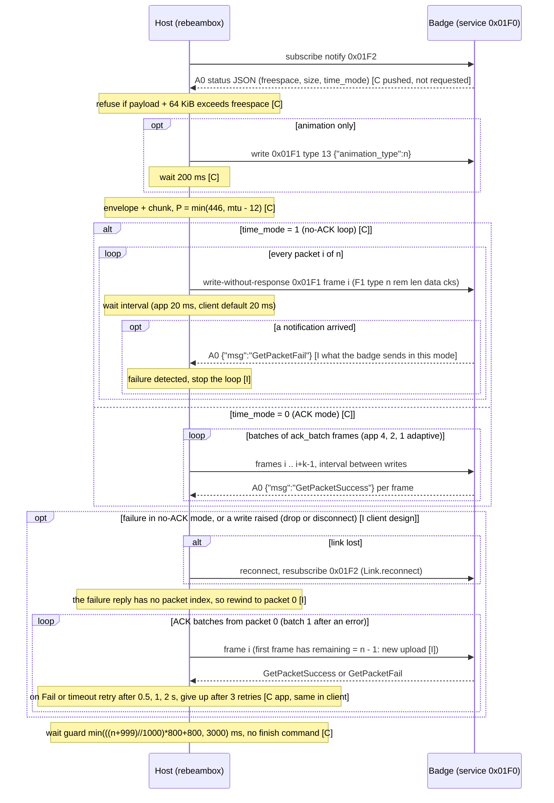
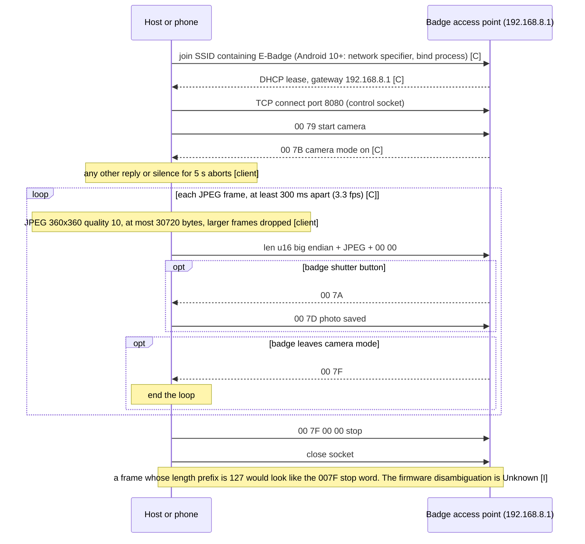

# Beambox / badge BLE protocol (v1 spec, static analysis of app 1.0.14)

Method: static reading of the decompiled app (jadx) plus smali for methods jadx failed on, and disassembly of one tiny native library. No hardware was available, so nothing here is tested on a badge. Every claim is tagged:

- [C] Confirmed from code (decompiled Java, smali or native disassembly)
- [I] Inferred (reasoned from code but not directly shown)
- [S] Speculative

Worked-example bytes come from `scripts/spec_vectors.py`, which only implements the formulas below. No app source or assets are copied.

## 0. The app contains THREE transports, selected by device name

[C] When the user taps a scanned device (o7/t6.java), the app tests the advertised name:

| Name test | Path | Section |
|-----------|------|---------|
| Name, upper-cased with non-alphanumerics removed, contains `NEO` or `BDEVICE` (from "B-Device") | "BadgeSdk" path (com.zijun.badgesdk): custom control service plus Jieli RCSP file transfer | 3 |
| Anything else that matches the product's stored name filter (keySignalName, set when the user picks a product) | "nn20" path (com.example.nn20.manager): service 0x01F0 | 2 |
| Wi-Fi products | TCP to 192.168.8.1 port 8080 (KeyConstant.DEVICE_IP/PORT); see docs/wifi-protocol.md | 5 |

[C] The BadgeSdk is a vendor SDK dedicated to "baji" (the Chinese term for pin badges) devices: it only accepts devices whose advertising data says type BAJI (see 3.1) and its picture-size and file-type enums mention a circle shape. [I] The Beambox+ round badge therefore most likely uses the BadgeSdk path. The nn20 path serves a sibling product family from the same vendor (names, a "Polly" pet device flow, Wi-Fi). Both are specified so a client can support either. Which one a real Beambox badge speaks must be confirmed with a capture (see 6).

[C] The scan itself is unfiltered (`startScan(null, LOW_LATENCY)`), names containing "BLE" are dropped in the device list, and filtering is done in app code.

## 1. Shared facts

- [C] GATT connect uses `connectGatt(autoConnect=false, transport=LE)`; connect timeout 15 s on the nn20 path, 30 s on the BadgeSdk control path.
- [C] Both paths request MTU 512 after connecting. nn20 falls back to 23 if the request is rejected. BadgeSdk control writes are split to (MTU - 6) bytes.
- [C] No Android bonding/pairing call (`createBond`) was found on either path. [I] The badge accepts unbonded connections; application-level handshakes (bind, RCSP auth) replace pairing.
- [C] Resolution: the app targets 368x368 on the nn20 path (constants and scaled bitmaps, `TARGET_WIDTH/HEIGHT` 360 exist but upload code scales to 368), and uses the device-reported picture size on the BadgeSdk path. The product text says 360x360 round; [I] the panel is 360 (or 368 including a margin for round masking) and the 368 canvas is cropped by the badge.
- [C] Images are always JPEG (quality 90 for still images and frames; AVI path uses ffmpeg `-q:v 5`). No raw RGB565 or other colour format is used anywhere in the upload path.

## 2. nn20 path (service 0x01F0)

### 2.1 GATT [C]
Base `0000xxxx-0000-1000-8000-00805F9B34FB`.
- Service 0x01F0; write characteristic 0x01F1 (written with WRITE_NO_RESPONSE, write type 1); notify characteristic 0x01F2.
- Connect sequence: connect, requestMtu(512), discoverServices, find service and both characteristics (missing any aborts), `setCharacteristicNotification(0x01F2, true)` and write ENABLE_NOTIFICATION (0x0001) to its CCCD 0x2902. The link is "ready" only after that descriptor write succeeds.
- GATT status 133 triggers a reflective `BluetoothGatt.refresh()`; status 8 means timeout; status 19 means the device rejected the connection.
- Service 0x03C4 (chars 0x03C5 write, 0x03C6 read) and the other UUIDs are defined in `BleProtocolConstant` but **never referenced** anywhere else in the code [C]. [I] They are leftovers for another hardware revision. UUIDs 0xAE00/AE01/AE02, 0xFFFF/FF01/FF02, 0x1812, 0xFD00 belong to bundled Jieli SDK and unrelated SDK code, not this path.

### 2.2 Frame, app to badge [C]
Big endian.

| Offset | Size | Field |
|--------|------|-------|
| 0 | 1 | Head 0xF1 |
| 1 | 1 | Type |
| 2 | 2 | Total packet count N |
| 4 | 2 | Remaining count: (N - 1 - index), counting down to 0 on the last packet |
| 6 | 2 | Data length L of this packet |
| 8 | L | Data |
| 8+L | 1 | Checksum = (0 - sum of all preceding bytes) & 0xFF |

Total frame length L + 9. A frame plus its checksum sums to 0 mod 256. Single-packet commands use N = 0 and remaining = 0.

### 2.3 Type codes [C]
`BleProtocolConstant` defines: 1 activate query, 2 OTA package, 3 boot animation, 4 watch face, 5 GIF animation, 6 album (still image), 7 get version, 13 set brightness/settings. Observed in use:
- 6: still image upload (flag TRUE passed to the sender).
- 5: animation upload (multi-image carousel, GIF, video-to-GIF), flag null.
- 13: JSON settings command. The only one seen: `{"animation_type":<n>}`, sent as a bare single-packet frame (no envelope) before an animation upload.
- 1, 2, 3, 4, 7 are defined but no caller was found in the analysed activities [I]; probably used by other screens or the badge firmware tooling.

### 2.4 Payload envelope and chunking [C]
For types 5 and 6 the stream to chunk is the ASCII text `{"type":<type>,"data":` followed by the raw media container bytes followed by `}`. This single byte string is split into packets of `P` data bytes where `P = min(446, max(23, MTU) - 12)`. With MTU 512, P = 446 (frame 455 bytes, still within MTU 512 minus 3 ATT bytes); with MTU 23, P = 11. At most 65535 packets. Type 13 JSON is sent as the data directly, without the envelope, limited to 446 bytes.

### 2.5 Reply frames, badge to app, on 0x01F2 [C]
| Offset | Size | Field |
|--------|------|-------|
| 0 | 1 | Head 0xA0 |
| 1 | 1 | Type |
| 2 | 2 | not read by the app ([I] zero or sub-page info) |
| 4 | 1 | Data length L (one byte, so max 255) |
| 5 | L | UTF-8 JSON text |
| 5+L | 1 | Checksum (0 - sum of bytes 0..4+L) & 0xFF |

Total length L + 6. Notifications may be split across several ATT notifications; the app appends them to a buffer, discards bytes before the first 0xA0, waits for L + 6 bytes, verifies the checksum, and repeats while data remains. A bad checksum drops that frame only.

JSON content: a status record (parsed only when L > 30) with keys `freespace` (KB), `allspace`, `time_mode` (1 = loop mode), `devname`, `brand`, `type`, `size`; and ACK records containing the text `GetPacketSuccess` or `GetPacketFail` (substring match). [I] The status record is pushed by the badge after notifications are enabled and again after uploads; no explicit request was found.

### 2.6 Flow control and ACK [C]
Two modes, chosen per upload:
- time_mode 1 (reported by the badge, or the app's stored loop switch) selects protocol 2, "no-ACK": every packet written back to back with a 20 ms interval; each write is guarded by a 2 s timeout waiting for the GATT write callback; a `GetPacketFail` aborts; early `GetPacketSuccess` is tolerated.
- Otherwise protocol 1, "ACK mode": batches of 4 packets (adaptive 4, 2, 1), inter-packet interval max(10 ms default, 50 ms floor set at start), one badge ACK expected per packet in the batch; the batch timer is interval x batch + 2.5 s. All ACKs success: advance and (after 20 or 50 good packets) step the batch size back up. Any `GetPacketFail`: retry from the failed packet with batch 1, waits 500 ms, 1000 ms, 2000 ms (cap 2000), at most 3 retries then fail. On a failed write the interval escalates 20, 40, 80 ms.
- Writes are WRITE_NO_RESPONSE in both modes, so the ACKs are application-level, not ATT.
- [C] After the last packet of a type 5 or 6 transfer the app waits an extra guard time `min(((N + 999)/1000) * 800 + 800, 3000)` ms before reporting success, to let the badge finish.
- [C] Minimum gap between separate uploads: 300 ms. A second upload while busy is rejected.
- [C] Free-space check before upload: the app refuses if `payload + 64 KiB > freespace KB * 1024` when `freespace` is known; if unknown it proceeds.
- [I] Whether ACKs are mandatory for the badge to accept data: no code path sends data without the badge having an ACK option, but the "no-ACK" mode proves the badge tolerates a stream without per-batch ACK; the 20 ms spacing there is the safe minimum.

### 2.7 Media containers [C]
All little endian. Sizes below are for BLE.

**Still image (type 6), "IMB" file, 36-byte header + JPEG**

| Offset | Size | Field |
|--------|------|-------|
| 0 | 4 | Signature 49 4D 42 00 ("IMB\0") |
| 4 | 4 | Constant 4 |
| 8 | 4 | JPEG length + 32 |
| 12 | 1 | Format 11 (JPEG) |
| 13 | 1 | 0 |
| 14 | 2 | 0 |
| 16 | 2 | Width (368, or 360 only if the caller passes 360; any other value is coerced to 360) |
| 18 | 2 | Height (same rule) |
| 20 | 4 | Data offset 36 |
| 24 | 4 | JPEG length |
| 28 | 4 | 0 |
| 32 | 4 | 0 |
| 36 | n | JPEG bytes |

Note the builder compares width and height to 368 and writes 368, otherwise 360. The upload code scales still images to 368x368 first.

**Animation (type 5), container with magic 0x12345678**

| Offset | Size | Field |
|--------|------|-------|
| 0 | 4 | Magic 78 56 34 12 |
| 4 | 4 | Address-list length = N*16 + 24 on BLE (N*16 + 32 for Wi-Fi) |
| 8 | 4 | Frame count N |
| 12 | 4 | Frame interval in ms |
| 16 | 12 | ASCII `output/<interval>ms`, zero padded or truncated to 12 bytes |
| 28 | 4 | Total file length minus 1 (written last) |
| 32 | 16*N | Frame table; entry i: 12-byte name `frame_%05d.` (1-based, exactly 12 characters) then u32 absolute file offset of frame record i |
| 32+16N | ... | Frame records, back to back |

Frame record at offset X: u32 X (its own offset), u32 offset of the next frame record (the last record points to the first), then a 32-byte-header-style block continuing: byte 11, byte 0, u16 0, u16 width, u16 height, u32 X+32, u32 JPEG length, u32 0, u32 0, then the JPEG bytes. The record header is 32 bytes counting the two offset words (4+4+1+1+2+2+2+4+4+4+4 = 32). Frames are 368x368 JPEG quality 90 on BLE. Interval: carousel uses user seconds x 1000; GIF import uses the source frame delays; one code path hard-codes 120 ms and another 100 ms.

### 2.8 Worked examples (generated by scripts/spec_vectors.py)
A. Command, type 13, `{"animation_type":1}` (20 bytes of JSON):
```
F1 0D 00 00 00 00 00 14 7B 22 61 6E 69 6D 61 74 69 6F 6E 5F 74 79 70 65 22 3A 31 7D 66
```
Check: head F1, type 0D, N 0000, remaining 0000, length 0014, 20 JSON bytes, checksum 66.

B. A 13-byte stand-in JPEG wrapped as IMB (49 bytes):
```
49 4D 42 00 04 00 00 00 2D 00 00 00 0B 00 00 00 70 01 70 01 24 00 00 00 0D 00 00 00 00 00 00 00 00 00 00 00 FF D8 FF E0 00 10 4A 46 49 46 00 FF D9
```
C. The same image sent as type 6 at MTU 23 (11 data bytes per packet), 7 packets:
```
F1 06 00 07 00 06 00 0B 7B 22 74 79 70 65 22 3A 36 2C 22 B2
F1 06 00 07 00 05 00 0B 64 61 74 61 22 3A 49 4D 42 00 04 20
F1 06 00 07 00 04 00 0B 00 00 00 2D 00 00 00 0B 00 00 00 BB
F1 06 00 07 00 03 00 0B 70 01 70 01 24 00 00 00 0D 00 00 E1
F1 06 00 07 00 02 00 0B 00 00 00 00 00 00 00 00 00 FF D8 1E
F1 06 00 07 00 01 00 0B FF E0 00 10 4A 46 49 46 00 FF D9 10
F1 06 00 07 00 00 00 01 7D 84
```
D. Animation container, 2 frames of the stand-in JPEG, 100 ms, 368x368, BLE (154 bytes):
```
78 56 34 12 38 00 00 00 02 00 00 00 64 00 00 00 6F 75 74 70 75 74 2F 31 30 30 6D 73 99 00 00 00
66 72 61 6D 65 5F 30 30 30 30 31 2E 40 00 00 00 66 72 61 6D 65 5F 30 30 30 30 32 2E 6D 00 00 00
40 00 00 00 6D 00 00 00 0B 00 00 00 70 01 70 01 60 00 00 00 0D 00 00 00 00 00 00 00 00 00 00 00 FF D8 FF E0 00 10 4A 46 49 46 00 FF D9
6D 00 00 00 40 00 00 00 0B 00 00 00 70 01 70 01 8D 00 00 00 0D 00 00 00 00 00 00 00 00 00 00 00 FF D8 FF E0 00 10 4A 46 49 46 00 FF D9
```
(Line breaks added for reading; it is one byte string.)

### 2.9 Full upload sequence, nn20 [C unless marked]
1. Scan (name match), tap device. Connect, MTU 512, discover, enable notifications. Wait for ready.
2. Prepare media: scale to 368x368, JPEG q90. Still image: wrap in IMB. Animation: build the 0x12345678 container.
3. Optional: read free space from the latest status JSON; refuse if too big.
4. Animation only: send type 13 `{"animation_type":n}` and wait 200 ms.
5. Wrap in the `{"type":..,"data":..}` envelope, chunk by P, build frames, write packets (WRITE_NO_RESPONSE) with the pacing and ACK rules of 2.6.
6. Wait the end-of-transfer guard time, then report success. No finish command is sent [C: none found]. The badge parses the stream by the JSON envelope and packet counters [I].


#### Sequence diagram 2.9a: nn20 upload, no-ACK loop and fallback
Matches `Nn20Session` in `rebeambox/session.py` (app behaviour [C]; the failure detection and fallback are client design [I]). Labels: [C] seen in app code, [I] inferred or client-only.



## 3. BadgeSdk path ("NEO" / "B-Device" names)

Three layers: advertising data, a custom control channel with its own frames, and Jieli RCSP over a second GATT connection used only for the file transfer.

### 3.1 Advertising [C]
Scan unfiltered. Parse the AD structure with type 0xFF (manufacturer specific) from the raw scan record; the payload must be at least 10 bytes:
- byte 0: device type tag (0xB5 watch, 0xB0 phone case, 0xB1 alarm clock, 0xB2 speaker, **0xB3 baji badge**). Only 0xB3 is accepted by the SDK scanner.
- byte 1: shape tag (0x6C square, **0x6D circle**).
- bytes 2..7: six-byte MAC-like identifier (printed as AA:BB:..).
- bytes 8..9: project number, little endian.
The 16-bit "prefix" is (type << 8) | shape.

### 3.2 Control service [C]
- Service `C2E6FD00-E966-1000-8000-BEF9C223DF6A`. Characteristics: `...FD01` (notify), `...FD02` (command write), `...FD03` (notify; also an alternate write target).
- A second pair, service 0x3802 with characteristic 0x4A02, is subscribed and used by a payment certificate component ("PayCertificationApi"); not needed for images [I].
- On discovery the app enables notifications (writes the CCCD with ENABLE_INDICATION, 0x0002) on FD01, FD03 and 4A02 one by one (serialised queue), then requests MTU 512. Write chunk size = MTU - 6 bytes; the next chunk is written 5 ms after the previous write completes. Writes use the default write type (with response) and are serialised through a queue: next command only after the write callback.
- After the connection is up the app waits 1550 ms and then sends the bind command.

### 3.3 Control frame [C]
| Offset | Size | Field |
|--------|------|-------|
| 0 | 1 | Head 0x9E |
| 1 | 1 | Checksum = byte sum (mod 256) of bytes 2..end |
| 2 | 1 | Flags: bit0 reserved, bit1 always 1 on commands the app sends, bit2 = 1 if payload+6 > 20, bits 3..6 a rolling sequence number 0..15 |
| 3 | 1 | Command |
| 4 | 2 | Payload length, little endian |
| 6 | n | Payload |

Replies use the same layout and are checksum-validated (head 0x9E and an extra rule: if byte 3 is 0xFF it is a generic response). If an incoming frame has flag bit1 set, the app answers with command 0xFF, payload `[cmd, 0]` to acknowledge it.

Generic response (cmd 0xFF, 2-byte payload): `[acked command, status]`, status 0 = OK. A response with acked command 0xDC is the awaited file-type ACK.

Commands (app to badge) and replies [C]:
| Cmd | Payload | Reply | Meaning |
|-----|---------|-------|---------|
| 0x60 | 13 bytes: flags (bit2 = 12 h clock, bit1 = non-Chinese locale), 6-byte device id, same 6-byte id again (little endian) | 0x61 | Bind. Id is a 32-bit hash of Android Build fields (see 3.4) |
| 0x02 | 7 bytes: year LE16, month, day, hour, minute, second | ack | Set time |
| 0x16 | 1 byte language code | ack | Set language |
| 0xC6 | `01` | 0xC7 | Get badge info (3.5) |
| 0xDA | none | 0xDB | Get picture sizes (3.5) |
| 0xDC | 1 byte file type (0x0C for badge media) | 0xFF [0xDC, 0] | Announce a file transfer |
| 0x29 | 1 byte (0x20 or 0x80 depending on protocol version) | 0x27 | Battery info |
| 0x81 | 1 byte (0 start camera action, 2 stop) | 0x81 | Remote camera shutter; also pushed by the badge |

Bind reply 0x61 [C, from the receive parser; the decompiler merged some branches, so treat offsets for protocol >= 26 as C with moderate confidence]. Payload offsets:
| Offset | Size | Field |
|--------|------|-------|
| 0 | 1 | state, 0 = success |
| 1..3 | 3 | protocol version as ASCII, trailing zeros trimmed; dots are removed and the rest parsed as an integer P (for example "2.9" gives 29). Default 23 if unparsable. Parsing requires payload length >= 23 |
| 4..13 | 10 | firmware version text (NUL padded) |
| 14 | 1 | platform id |
| 15 | 1 | serial number low byte (P >= 26: high byte at 16, i.e. serial = b15 or b16<<8) |
| next 4 | 4 | function config word 0 (little endian u32 via helper; P < 24: only 2 bytes, u16) |
| next 4 | 4 | function config word 1 (P >= 27) |
| next 8 | 8 | function config word 2 (P >= 29) |
| then | 5 | UI version text |
The 16-byte "function bytes" blob the SDK exposes is word0 | word1 | word2 for P >= 29 (8 bytes for 27..28, 4..8 below). Function bit 6 (0x40) of word 1 switches an internal protocol level to 7. The SDK itself only needs state; function flags are feature gates and not needed to upload. Base offset of the first function word: 17 for P >= 24 (16 when P < 24).

### 3.4 Device id [C]
`id = (int32) hashCode("35" + concat(len(s) mod 10 for s in [BOARD, BRAND, DEVICE, DISPLAY, HOST, ID, MANUFACTURER, MODEL, PRODUCT])) & 0xFFFFFFFF`, written as 6 bytes little endian (upper two bytes zero). [I] The badge only stores the id to recognise the phone; any 32-bit constant is a plausible substitute.

### 3.5 Info replies [C]
- 0xDB picture sizes [C]: 20 bytes, or 24 when the badge also reports preview size, ten or twelve big-endian u16 in this order: albumShrink W,H | album W,H | dialShrink W,H | dial W,H | map W,H | (optional) preview W,H. Defaults when absent: album 400x496, album shrink 128x(constant CMD_GET_HEALTH_DATA), preview 128x128. [I] For a 360x360 circle badge the photo size to use is the preview size from this reply; confirm with a real reply.
- 0xC7 [C]: byte 0 = 1, then u16 LE at 1, 3, 5, 7 (screen W, screen H, picture W, picture H as named by the SDK) and u32 at 9 = memory KB.
- Resolution handling per model: [C] the picture size is read from the badge (0xC7), so there is no fixed per-model table on this path; the app validates width and height > 0.

### 3.6 File transfer [C unless marked]
1. [C] Format check: only JPEG (FF D8 FF) or AVI (RIFF....AVI ) files are allowed.
2. [C] Refresh storage: send 0xC6, require reply, then `fileSize <= memoryKB * 1024`, else error.
3. [C] Send 0xDC with file type 0x0C and wait up to 5 s for the 0xFF acknowledgement of 0xDC.
4. [C] Start the Jieli RCSP large-file transfer on the RCSP connection (3.7).
5. [C] 20 s without progress aborts. No explicit finish command on the control channel [C: none seen].

For a still photo `sendPhoto` skips the memory check and the file-type handshake and calls the RCSP transfer directly with the JPEG [C].

Media files for this path [C]:
- Still: plain JPEG quality 90, size from the device picture size.
- Animation or video: an **AVI with MJPEG video** generated by ffmpeg with the command line `-r <fps> -i frame_%05d.jpg -vf "scale=W:H:force_original_aspect_ratio=disable,setsar=1" -c:v mjpeg -q:v 5 -t <dur> -an -f avi`, fps = 1000 / max(interval_ms, 30). With a soundtrack: add a second input, `-map 0:v:0 -map 1:a:0? -c:a pcm_s16le -ar 16000 -ac 1 -shortest`. So audio is PCM 16 kHz mono and frames may be as fast as 30 ms apart (about 33 fps).
- So the BadgeSdk path does **not** use the IMB or 0x12345678 containers.

### 3.7 Jieli RCSP layer [C]
- Second GATT connection created by the Jieli SDK to the same address, using service 0xAE00 (write 0xAE01, notify 0xAE02) [C UUIDs]. Started right after bind succeeds; `isTransferReady` requires bind success and the Jieli link up [C].
- RCSP frame [C]: `FE DC BA` | flag (bit7 = command, bit6 = wants response) | opcode | length (u16 big endian) | payload | `EF`. For commands the payload starts with a sequence-number byte; for responses it starts with status then sequence number [C: packSendBasePacket].
- Authentication: see 3.7.1 (algorithm recovered, byte exact).
- Link settings of the Jieli stack [C]: requests ATT MTU 512 (configured 509 plus 3); each RCSP frame is split into writes of at most MTU minus 3 bytes by a sender thread; descriptors are written with write-with-response; data writes use the characteristic's own write type (the app never forces one) [I: write without response, typical for 0xAE01]; incoming notifications are reassembled by scanning for `FE DC BA` and the length field. Until auth succeeds, raw notifications go to the auth handler instead of the RCSP parser.
- Frame details [C]: command frame body = `sn` then parameters; response frame body = `status` then `sn` then parameters; opcode 0x01 (Data) inserts one inner opcode byte after sn. `sn` is a per-device counter, random start, wraps at 256. Flag bit6 (0x40, "wants response") is set for commands that have a reply (types 2 and 3 in the SDK), clear for plain commands and Data. Multi-byte integers are big endian.
- Pre-transfer state the SDK gathers [C]: `GetTargetInfo` (opcode 0x03, params `FF FF FF FF 00` = mask all, platform 0). The reply is a list of LTV records `len(1) type(1) data` where type 13 = protocol MTU (u16 send MTU, optional second u16 receive MTU; default 530) and type 21 = file configuration (u32; bit0 = packet CRC16 supported, bit1 = get file by name with device, bit2 = small file transfer). Then `GetSysInfo` (opcode 0x07, params `FF 00 00 00 04`): reply `function(1)` then LTV attributes; attribute type 2 is the storage list, version byte then LTV type 1 entries `online(1) index(1) [handle u32 if online]`. Index to name: 0 USB, 1 "SD Card 0", 2 "SD Card 1", 3 Flash, 4 LineIn, 5 Flash2, 6 Flash3. The app picks the entry named "SD Card 1" if online, else the first online USB or SD (types 0 and 1) entry; the device handle is the u32.
- Large file transfer sequence [C, TransferTask]:
  1. CRC16 of the whole file is computed (init 0, fed in 2048 byte pieces, running value passed along: plain CRC-16/XMODEM).
  2. `NotifyPrepareEnv` opcode 0x21, param `00` (env = transfer large file). Reply status 0.
  3. If the target reports packet CRC16 support (or the info is missing): `DeviceExtendParam` opcode 0x27, params `op(1)=00 | dev handle u32 | hasCrc16(1)=01`; the reply carries `op(1)` then `hasCrc16(1)`; the second byte tells whether the device wants CRC16 in each data packet. If CRC16 is unsupported this step is skipped and no per-packet CRC is used.
  4. `StartLargeFileTransfer` opcode 0x1B, params `u32 file size | u16 file CRC16 | path bytes`. Path = optional output dir plus `%08x.tmp` and a terminating NUL, where the hex is Java `String.hashCode` of `fileName + lastModifiedMillis` (the SDK default output dir is empty, so the path is just that name). Encoding is the platform default (UTF-8, effectively ASCII here), NOT UTF-16. Reply status 0 and params `u16 transfer MTU` (default 265 if absent, must be > 0; status 2 means busy, nonzero with MTU 0 means refused).
  5. The device pulls data: it sends command `LargeFileTransferOp` opcode 0x1D with params `op(1)=00 | u16 size | u32 offset`. The app (ignoring a repeat of the same offset or sn) reads `min(size, fileLen - offset)` bytes at that offset and answers NOT with a normal response but with a series of Data frames (opcode 0x01, inner opcode 0x1D, no response flag). Each frame carries up to `transfer MTU` data bytes and body `seq(1) | [crc16 u16, only if the device said hasCrc16] | data`; `seq` restarts at 0 for each read request and wraps at 256; crc16 is XMODEM over that frame's data bytes only. Frames are sent one after another after the previous write completes.
  6. The device may send `GetName` opcode 0x20 (a command with no params) when it needs the final file name; the app replies (response frame, status 0, or status 1 when the retry count reached the limit 9, or 32 for names longer than 9 characters) with the name bytes: strip control characters and `/ : < > \ "`; split at the last dot into stem and extension; retry suffix = last 3 chars of `"000" + retry` for retry > 0. If GBK(stem+suffix) is under 9 bytes and the extension is under 5 chars: GBK(stem+suffix+ext) + `00 00`; otherwise ASCII `\U` + UTF-16LE(stem+suffix+ext) + `00 00`. The retry counter increases on every GetName.
  7. Completion: the device sends `StopLargeFileTransfer` opcode 0x1C with param `reason(1)` (0 = success; 1 FAT write error, 2 data over limit, 3 and 4 other errors). The app responds status 0 and reports 100 percent. Silence for the SDK timeout aborts with a Cancel (opcode 0x1E, app to device with reply, or device to app with the app answering status 0).
- Worked frames (all [C] layouts, generated by `rebeambox/rcsp.py`, covered by `tests/test_rcsp.py`):
```
prepare env           FE DC BA C0 21 00 02 01 00 EF
device extend         FE DC BA C0 27 00 07 02 00 11 22 33 44 01 EF
start (sn 5, size 0x1000, crc BEEF, name "772e7245.tmp")
                      FE DC BA C0 1B 00 14 05 00 00 10 00 BE EF 37 37 32 65 37 32 34 35 2E 74 6D 70 00 EF
data frame (sn 6, seq 0, crc 6131, bytes 00..03)
                      FE DC BA 80 01 00 09 06 1D 00 61 31 00 01 02 03 EF
get name reply "a.jpg" payload 61 2E 6A 70 67 00 00
```
- File CRC16 [C, from native disassembly of libjl_crc.so]: CRC-16/XMODEM (polynomial 0x1021, initial value passed in as 0, no reflection, no final xor), nibble-table implementation; check value of "123456789" is 0x31C3.
- Worked control frames [C]: file type announce `9E EB 02 DC 01 00 0C`; get info `9E CA 02 C6 01 00 01`.

### 3.7.1 RCSP authentication (libjl_auth.so) [C, verified by emulation]
Where it runs: the Jieli helper (`BluetoothHelper`, option `useDeviceAuth`, default true) starts auth on every new connection before any RCSP frame. Auth messages are RAW GATT writes on 0xAE01 and raw notifications on 0xAE02 (not RCSP framed). Timeout 5 s (`setAuthTimeout(5000)`). Messages (17 bytes or 5 bytes):
- `00 | R[16]`: a challenge (random 16 bytes).
- `01 | E1(R)`: the answer to a challenge.
- `02 70 61 73 73` ("\x02pass"): auth accepted.
- Reset-auth-flag command, sent first by the app: `FE DC BA C0 06 00 02 00 01 EF` (a normal RCSP frame, command opcode 0x06, payload `00 01`), then 50 ms later the app's own challenge.

Exchange [C, from RcspAuth.startAuth / handleAuthData]:
1. App sends reset-auth-flag frame, waits, then sends `00 | Rapp` (16 random bytes from native `rand()`, unseeded).
2. Badge replies `01 | X`. App computes the expected `01 | E1(Rapp)` and compares all 17 bytes; mismatch is error 40980. On match the app sends `02 70 61 73 73`.
3. The badge sends its own challenge `00 | Rdev`; the app replies `01 | E1(Rdev)` (error 40979 if the write fails).
4. Badge sends `02 70 61 73 73` when it accepts the app; the app then marks the device authenticated (if the badge never sends it, a 5 s timer reports failure). The order is fixed: the app's challenge is verified first (the app ignores a device challenge until its own check passed).
A client must therefore implement both directions; the only secret is the constant default key below, which is embedded in the library.

Native layout [C]: JNI natives registered in JNI_OnLoad for class `com/jieli/jl_rcsp/impl/RcspAuth`: `nativeInit`, `getRandomAuthData` (returns `00` + 16 bytes of libc `rand()`), `getEncryptedAuthData(byte[17])` (returns `01` + E1(addr, input[1..16], key)), `setLinkKey(byte[16])` (replaces the key; the app may pass a per-device key, see below). Constants in `.data`: key `06 77 5F 87 91 8D D4 23 00 5D F1 D8 CF 0C 14 2B`, six-byte "address" `11 22 33 33 22 11`.

Algorithm [C]: E1 as in the Bluetooth Core Specification legacy authentication, on SAFER+ with the standard tables (exp = 45^i mod 257, log inverse, bias B_p[i] = e[e[17p+i+1]]):
```
T   = Ar(K, R)                        # 8 rounds SAFER+, key schedule rotl3 of 17-byte key
M[i]= (T[i] xor R[i]) + A[i mod 6]    # A = 6-byte address, mod 256
K~  = K with per-byte offsets  (sub 17,xor E5,sub 21,xor C1,sub 4D,xor A7,sub 6B,xor 83,
                                xor E9,sub 1B,xor DF,sub 3F,xor B3,sub 59,xor 95,sub 7D)
OUT = Ar'(K~, M)                      # all 16 bytes returned (not truncated to 4)
```
Ar' differs from Ar only in that M is folded into the state before round 3 using the same xor/add pattern as the round key (xor on byte positions 0,3 mod 4, add on 1,2). Round layout: key K(2r-1) xor/add (xor on positions i mod 4 in {0,3}), exp on positions 0,3,4,7,8,11,12,15 and log on the rest, key K(2r) add/xor, then four 2-PHT layers separated by the Armenian shuffle (8,11,12,15,2,1,6,5,10,9,14,13,0,7,4,3). Output transform XORs/ADDs K17.
Reference implementation: `rebeambox/jl_auth.py` (`e1`, `encrypt_challenge`). Test vectors in `tests/test_jl_auth.py` were produced by emulating the real `function_E1test` (tools/emulate_jl_auth.py, unicorn) and agree with the Python code on 50 random key, address and challenge combinations. Example: key default, address fixed, R = 16 zero bytes gives `9e43df377b3a46ce751634667e215de5`.
Unresolved [I]: the device side cannot be checked without hardware; the app itself always uses the default key, not one injected through `setLinkKey` (Confirmed: no code in the app calls `setLinkKey`/`setDeviceConnectionLinkKey`, so the default key is used); the device side is expected to run the same E1 with the same constants.
Note the same E1/E21/SAFER+ family also appears in `function_E21` (E21(rand, addr) with last rand byte xor 6), exported but not called by the JNI natives.

### 3.8 Full upload sequence, BadgeSdk
1. Scan unfiltered; accept AD type 0xFF with byte0 = 0xB3; shape 0x6D = circle. (Name test NEO / B-Device as in 6.1.)
2. Connect control GATT; discover; subscribe FD01, FD03, 4A02; MTU 512.
3. Wait 1550 ms; send 0x60 bind; wait for 0x61 with state 0.
4. Start the Jieli RCSP connection to the same address (service 0xAE00, notify 0xAE02 enabled, MTU change attempt), run auth (3.7.1, both directions, 5 s limit), then GetTargetInfo and GetSysInfo (3.7) to learn MTU, CRC16 support and the storage handle.
5. After bind the app sends time (0x02), language (0x16), and info request (0xC6) to learn picture size and memory; 0xDA gives the picture-size table.
6. Prepare JPEG or AVI at the reported picture size.
7. Memory check (0xC6), file-type announce (0xDC, 0x0C, wait ACK 0xFF [0xDC, 0]), then the RCSP large-file transfer (3.7: prepare env, device extend, start, serve the device's read requests, answer GetName, handle Stop) with a 20 s no-progress watchdog.
8. Done when the device sends Stop with reason 0; no further command seen.


#### Sequence diagram 3.8a: BadgeSdk with RCSP (dual GATT)
Matches `BadgeSession` and `RcspSession`. Control service C2E6FD00 and the Jieli service 0xAE00 are separate GATT links to the same address in the app [C]; the client uses one `Link` and checks that both services are present [I]. Auth bytes are raw writes on 0xAE01, not RCSP frames [C].

```mermaid
sequenceDiagram
    participant H as Host
    participant C as Badge control (C2E6FD00: FD02 write, FD01 and FD03 notify)
    participant J as Badge Jieli (0xAE00: AE01 write, AE02 notify)
    H->>C: subscribe FD01 and FD03
    Note over H: wait 1550 ms [C]
    H->>C: 9E bind 0x60 (device id, 12/24 h)
    C-->>H: 0x61 bind reply, state 0 = ok [C]
    H->>C: 0x02 time
    H->>C: 0xC6 info query
    C-->>H: 0xC7 screen, picture size, memory KB
    H->>C: 0xDA picture sizes
    C-->>H: 0xDB twelve big-endian u16
    Note over H,J: Jieli authentication, raw bytes [C, verified by emulation of libjl_auth.so]
    H->>J: subscribe AE02
    H->>J: reset frame FE DC BA C0 06 00 02 00 01 EF
    H->>J: 00 + R (16 random bytes)
    J-->>H: 01 + E1(R)
    Note over H: client verifies E1(R) with default key 06775f87918dd423005df1d8cf0c142b and address 112233332211
    H->>J: 02 70 61 73 73
    J-->>H: 00 + Rdev (16 bytes)
    H->>J: 01 + E1(Rdev)
    J-->>H: 02 70 61 73 73
    Note over H,J: RCSP parameter negotiation (frames FE DC BA flag opcode len body EF)
    H->>J: 0x03 GetTargetInfo
    J-->>H: LTV list, MTU type 13, CRC support type 21
    H->>J: 0x07 GetSysInfo (storage list)
    J-->>H: storage entries, client picks online storage handle
    H->>J: 0x21 NotifyPrepareEnv
    opt badge reports packet CRC16 support
        H->>J: 0x27 DeviceExtendParam (storage handle, app has CRC16)
        J-->>H: reply, byte 1 = 1 means per-packet CRC16
    end
    opt animation or video (AVI) [C]
        H->>C: 0xDC file type 0x0C
        C-->>H: 0xFF generic ack [0xDC, 0]
    end
    Note over H,J: chunked large-file transfer (badge pulls)
    H->>J: 0x1B StartLargeFile (size, CRC16 of file, temp name)
    J-->>H: transfer MTU u16
    loop until Stop
        J->>H: 0x1D read request (size, offset)
        H->>J: Data frames 0x01/0x1D, each seq + optional CRC16 + up to MTU bytes
        opt name lookup
            J->>H: 0x20 GetName
            H->>J: name reply (retry counter, status 1 after the limit)
        end
    end
    J->>H: 0x1C StopLargeFile reason 0 = success
    H->>J: response frame
    Note over H: 20 s without progress: send 0x1E cancel and abort [C]
    Note over H,J: still images skip the 0xDC step; whether a real badge exposes 0xAE00 at all is Unknown (third parties report only 0x01F0 on NN units)
```

## 4. Checksums summary
| Where | Algorithm | Status |
|-------|-----------|--------|
| nn20 frames (both directions) | (0 - sum of preceding bytes) & 0xFF | [C] |
| BadgeSdk control frames | sum of bytes from flags onward, mod 256, stored at byte 1 | [C] |
| RCSP file | CRC-16/XMODEM | [C] |
| RCSP frames themselves | no checksum seen in the frame; link-level integrity only | [I] |
| IMB / 0x12345678 containers | no checksum or CRC inside | [C] |

## 5. Wi-Fi path [C]
Full analysis in docs/wifi-protocol.md. Summary: the badge is a SoftAP and DHCP gateway (192.168.8.1); the phone joins the SSID containing the product signal name (default `E-Badge`) and binds the process to that network. TCP port 8080 carries (a) 2-byte big-endian control words (0x0069 query storage, 0x005F end, 0x0079 start camera, 0x007B camera on, 0x007A shutter event from the badge, 0x007D photo saved, 0x007F stop, 0x0000 terminator), (b) live camera frames as `[len16][JPEG 360x360 q10, at most 30720 bytes][0000]` at most every 300 ms, and (c) a handwritten `POST /upload` with `X-Filename: NN.bin` carrying the IMB or 0x12345678 container (Wi-Fi address-list length N*16+32) in 6144-byte chunks. Selection is by the server product `deviceType` (`WiFi` vs `BT`), not by name. Client: `rebeambox --transport wifi`, `rebeambox stream`.


#### Sequence diagram 5a: Wi-Fi live camera
Matches `WifiSession.stream` and `docs/wifi-protocol.md` [C]. Control words are 2 bytes big endian; the frame loop spacing and the 30720 byte limit are [C]; dropping oversize frames is client behaviour.



## 6. Transport selection and remaining unknowns (second code pass)

### 6.1 Which transport a Beambox+ uses [C for the mechanism, I for the verdict]
- [C] The scan screen (BluetoothDeviceActivity) lists a device when its name does NOT contain "BLE" and either contains the product signal name stored from the server's device-selection record (`keySignalName`, a field of the product list the app downloads, plus per-product `name` and `type` = "BT" or "WiFi") or matches the hard-coded BadgeSdk names "NEO" or "B-Device" (case-insensitive, non-alphanumerics ignored, substring).
- [C] After the user taps a device, a name that matches NEO / B-Device goes to the BadgeSdk path (control service C2E6FD00, Jieli RCSP); any other BLE name goes to the nn20 path (service 0x01F0). The status check for "connected" follows the same name test, so the two never mix.
- [C] The three product names handled specially in the device-selection code are the pet products "POLLY", "NEMO" (and a Chinese pet-badge name), which use extra pet screens; they are not the image badge flow. Beambox+ itself (title strings: "Dynamic badge", "Dynamic avatar", "LED badge", "Beambox"; operation text: press the badge Bluetooth button once to enable APP transfer; long press 2.5 s to send to another badge) is the badge product.
- [C] The product signal name list lives on the server, not in the APK (no local table found in assets, resources or code). It therefore cannot be proven from the APK which name the Beambox+ hardware advertises.
- [I] Verdict: the app was built around the BadgeSdk ("baji badge" device tag 0xB3, circle shape 0x6D, 360 px class circle badge) and the only hard-coded names are NEO and B-Device, so a current Beambox+ unit most likely advertises a name containing NEO or B-Device and uses the BadgeSdk path. The nn20 path serves older or other products whose names come from the server (and which must not contain "BLE"). Decide at runtime exactly as the app does: name test first, then service discovery (C2E6FD00 present = BadgeSdk; 0x01F0 present = nn20).

### 6.2 nn20 status JSON [C]
The app only ever builds two kinds of frames on 0x01F1: type 13 settings JSON and the type 5/6 data stream (the constants for types 1 and 7, "activate query" and "get version", are defined but never used). So the status record (`freespace`, `allspace`, `time_mode`, ...) cannot be a reply to a request; it is pushed by the badge on notify (after the CCCD is enabled, after uploads and apparently after settings), and the app caches the last one. Do not wait for it before sending; treat missing status as "unknown free space".

### 6.3 Resolved in this pass
- Jieli auth: byte exact, with reference code and vectors (3.7.1).
- RCSP payload encodings, file name encodings, DeviceExtendParam, large-file sequence, GetTargetInfo and storage discovery (3.7).
- Bind reply 0x61 and picture size 0xDB layouts (3.3, 3.5).
- Transport selection logic (6.1) and status push (6.2).

### 6.4 Still unknown (needs a badge or a capture)
1. Exact advertised name of a Beambox+ and which service set it exposes (decides nn20 versus BadgeSdk).
2. Whether the badge accepts data when auth is skipped; whether it uses the default key (the app always does).
3. The unsolicited device-side RCSP traffic during connect (the SDK also answers a few device queries such as time and MTU settings that are not needed for a one-file transfer; whether the badge insists on them is untested).
4. Whether the ACK/pacing rules (nn20) are enforced or only used for reliability.
5. Behaviour and limits for streaming (see docs/hardware-prediction.md and docs/streaming-plan.md).
6. Bind reply offsets for protocol >= 26 are read from decompiled code in which jadx merged branches; a real reply would confirm them.


## 7. Third-party hardware evidence and corrections (2026-10)
Reports on real Niji and Nano units (details and links in docs/models.md). Tag [W] = reported by others, not verified by us.
- [W] Transport: NN-family units expose only service 0x01F0 (01F1 write without response, 01F2 notify). No 0xAE00 and no C2E6FD00 were seen. So nn20 is the primary transport for NIKKO, NANO and NIJI [I for Nikko]. The BadgeSdk/RCSP sections of this document describe the app's other path and remain unverified on hardware.
- [W] Advertising: only while the pairing screen is shown; name `E-badge`. A Nano on USB power was seen as `Nikko-badge(BLE)` (the app hides names containing BLE).
- [W] Status JSON is pushed periodically on 01F2 with type 13: `allspace`, `freespace` (KB), `devname`, `size` as the string "368,368", `time_mode`, `brand`. Replies carry `GetPacketSuccess`. This supports the "pushed, not requested" conclusion of 6.2 and the A0 reply layout.
- [W] Frame layout, big-endian counters and two's-complement checksum match section 2 exactly. 496 data bytes per packet worked (app constant 446).
- CORRECTION [W]: a still sent as type 6 with a raw JPEG is stored (free space drops) but shows black. A still sent as type 5 with the 0x12345678 container (one frame, interval 3000 ms, 368x368 JPEG) displays correctly. The IMB type 6 path of section 2.7 was not tested by that reporter (they sent a raw JPEG), so type 6 with IMB remains [I]. The client defaults to type 5 and offers `--nn20-still album`.
- [W] The container, directory entry (12-byte name plus u32 offset) and 32-byte frame header in a Nano's flash match section 2.7. Header size field 360, JPEG data 368.
- [C] Model-specific code: only the NIJI video window (5 s versus 10 s). See docs/models.md section 4.


## 8. Badge-originated notifications, status fields and input events (code search, 2026-10)
Question: does the badge ever report touch coordinates, button, switch, battery or mode events? Answer: touch coordinates are never reported on any path. The complete inventory [C], found by reading every parser reachable from a notification callback:

nn20 path (0x01F2 replies): only UTF-8 JSON. The app's status record model has exactly these fields: `allspace` (int), `brand` (int), `devname` (string), `freespace` (int, KB), `size` (string, picture size such as "368,368"), `time_mode` (int), `type` (int). Used fields: `freespace` (storage display) and `time_mode` (1 selects the no-response loop protocol: the app labels the switch "Bluetooth no-response loop mode" and sends at a 20 ms interval without waiting for acknowledgements; any other value selects acknowledged batches). `GetPacketSuccess` and `GetPacketFail` texts are acknowledgements. No battery, charge, button, touch, motion, screen or mode-change field exists in the model and none is read elsewhere (a full-tree search for these names found nothing in the nn20 code). Unknown extra JSON keys would be ignored by the app, so a badge may send more; the first-session capture should check.

BadgeSdk path (0x9E control channel and RCSP): the connection class reacts to exactly these incoming command codes: 0x61 bind reply, 0xC7 device info, 0xDB picture sizes, 0xFF command ack, 0x27 battery reply (two bytes: status, level; requested with command 0x29 and a one-byte argument), and 0x81 camera command (one byte). Camera command values handled by the app: 1 and 3 = take a photo (badge button as a remote shutter), 2 = leave camera mode, 4 = a preview-related request; the app starts and stops camera mode with command 0x81 and argument 0 (enter) or 2 (exit). Other commands the vendor library can decode (a generic table shared with other Jieli based products: 0x16, 0x17, 0x21 to 0x26, 0x28, 0x2E, 0x2F, 0x30, 0x32, 0x40, 0x49, 0x52, 0x70, 0x73, 0x80 to 0x83, 0x88, 0x8E to 0x90, 0xD6, 0xE8 and others) are not consumed by any app screen. Touch: there is no parser or listener with x and y fields anywhere.

Wi-Fi path: single control words only (0x007A shutter, 0x007B camera on, 0x007F camera off, 0x006A/0x006B upload start ok/failed, text `SD:<n>KB` storage). No touch, battery or status JSON.

Consequences for the client: (1) the Niji touch display is used locally by the badge firmware; no touch stream is exposed to the app, so a remote-control or drawing-from-touch feature cannot be built from the documented protocol. [I] The badge may still send undocumented notifications; capture with nRF Connect while touching the screen (first-session checklist). (2) Battery level is available only on the BadgeSdk path (0x29 then 0x27); no battery on nn20 or Wi-Fi in the app. (3) The shutter event is the only button event: BadgeSdk 0x81 value 1 or 3, Wi-Fi 0x007A. (4) The scrolling-text screen ("danmaku") on BLE products renders text locally into an animation (duration chosen 1 s and up) and uploads it as a normal animation, [I] there is no separate text protocol.


## 9. Client behaviour added after first-contact planning (2026-10) [client design, not badge facts]
- Packet size [C for the formula, I for the badge accepting it]: data bytes per nn20 packet P = min(446, mtu - 12) with the ATT MTU floored at 23 (so P is at least 11); a frame is P + 9 bytes and always fits one ATT write (mtu - 3). The MTU comes from the Bluetooth stack (`BleakLink.mtu`); Web Bluetooth does not report it, so the web harness takes it as input and halves it on a write error.
- Pacing [I]: the app waits 50 ms per packet in ACK mode and 20 ms in no-ACK mode; the client defaults to 20 ms in both (`--packet-interval-ms`) and ACK batches of 4 (`--ack-batch-size`), dropping to batches of 1 after a failure. These are tuning values for hardware test H4.
- No-ACK fallback [I]: with `time_mode` 1 the client streams without ACKs. A `GetPacketFail` reply or a write error switches to ACK batches and restarts the stream from its first packet (a first packet, remaining = n - 1, starts a new upload in the software badge; whether a real badge accepts a restart without a reset is unverified). After a write error the link is reconnected when the transport supports it.
- Qualification [C for what is sent]: `probe --qualify` sends nothing to nn20 badges and only the 0xC6 info query (read-only) to BadgeSdk badges. Whether 0xC6 is answered before bind is unknown [I]; a silent badge gives verdict PARTIAL, not FAIL.
- Capture replay: `tools/replay_pcap.py` reassembles ATT writes to 0x01F1 (nn20), C2E6FD02 (control) and 0xAE01 (RCSP) from btsnoop (datalink 1001/1002), pcap and pcapng (linktype 187/201), maps handles from discovery PDUs when present, otherwise classifies by frame shape. RCSP data-chunk CRC16 presence is detected from the first chunk.
